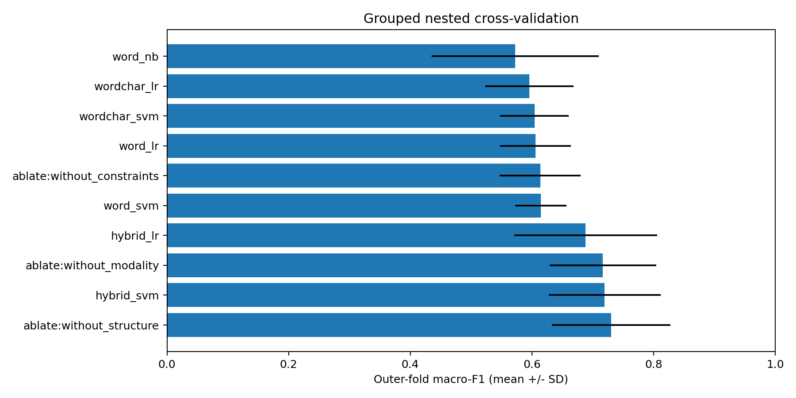
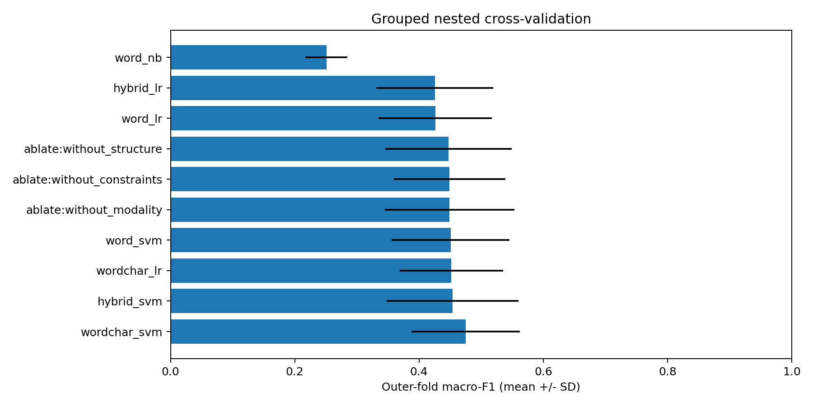

# Evaluating Lightweight Textual and Surface-Linguistic Features for Cross-Project Software Requirements Classification

**Author:** [Student name]  
**Affiliation:** [Department, university]  
**Corresponding author:** [Email]  
**Manuscript status:** Exploratory empirical draft for supervisor review. Benchmark experiments have been executed; application implementation and usability evaluation remain planned. Methods and project library versions are restricted to availability before 1 April 2020. This is a retrospective study executed on 1 November 2026, not a paper authored or submitted in 2020. Author and affiliation fields remain for the student to complete.

## Abstract

Natural-language software requirements mix descriptions of behavior with quality constraints. This exploratory study evaluates lightweight functional/non-functional classification using word term frequency–inverse document frequency (TF-IDF), character n-grams, and fixed surface-linguistic features. An original-format PROMISE artifact retrieved from a current mirror contained 625 requirements; documented exclusions and duplicate removal retained 620 requirements across 15 projects. Five-fold outer and three-fold inner project-grouped validation compared Naive Bayes, logistic regression, linear support vector machines, and feature ablations using a historical Python 3.7.6/scikit-learn 0.22.2.post1 environment on CPU. For the primary binary comparison, word-plus-surface linear SVM achieved mean outer-fold macro-F1 of 0.7194 (SD 0.0918), compared with 0.6144 (SD 0.0420) for word-only SVM; four of five paired fold differences were positive. Removing constraint features reduced the hybrid result to 0.6138. Exploratory NFR subtyping was harder: word-plus-character SVM achieved the highest observed mean of 0.4752 across 11 labels. Results are descriptive, affected by rare-class support and exploratory cleaning, and do not establish statistical significance or external industrial generalization. A companion review application is specified using React, FastAPI and MongoDB. The replication package includes data notices, code, splits, predictions and measured outputs.

**Keywords:** requirements engineering; functional requirements; non-functional requirements; text classification; cross-project evaluation; TF-IDF; reproducibility.

## 1. Introduction

Requirements specifications communicate expected behavior and quality constraints between stakeholders and developers. Their natural-language form makes them accessible, but it also permits variation in vocabulary, structure, and precision. Statements describing an action may appear alongside constraints concerning security, performance, usability, or availability. Classification can help reviewers organize such statements, while quality checks can direct attention to possible duplication or vague wording.

Prior research has investigated automated non-functional requirements classification [1] and the effect of preprocessing and classifier choice [2]. These studies establish that requirements classification is an existing research problem rather than a new task introduced here. The present project therefore emphasizes controlled comparison, project separation, computational practicality, and integration into a review workflow. It does not claim that combining standard features constitutes a new learning algorithm.

The motivating constraint is a two-semester undergraduate software engineering project that can be executed without extended accelerator training. Sparse text representations and linear classifiers offer a practical basis for this investigation. A useful study can test whether small, interpretable feature additions generalize across source projects, even if the proposed additions do not outperform established baselines.

The contributions and engineering deliverables are: (i) a reproducible comparison of lightweight textual representations and classifiers under project-grouped nested validation; (ii) an ablation analysis of fixed surface-feature groups; and (iii) a document-review application that preserves source locations, model versions, reviewer corrections, and analysis history. The empirical comparison and replication artifacts are completed for the retrieved corpus. Application implementation and its usability evaluation remain FYP deliverables.

## 2. Background and related work

### 2.1 Automated requirements classification

Cleland-Huang et al. investigated automated classification of non-functional requirements, including properties such as security, performance, and usability [1]. Their work provides an early basis for treating requirements classification as support for requirements engineering. It does not imply that every requirement has a unique or uncontested category.

Abad et al. examined preprocessing and classification approaches using 625 requirements from the tera-PROMISE repository [2]. Their study is particularly relevant because it demonstrates that representation and preprocessing choices already form part of this research area. The experiment must consequently compare its choices fairly against existing lightweight methods and avoid presenting preprocessing alone as an established novelty claim.

The original NFR dataset is attributed to Cleland-Huang, Mazrouee, Liguo, and Port [3]. The exact retrieved artifact, class distribution, and source-project identifiers must be verified before experimentation. Later expansions and relabelings are outside the selected historical dataset scope unless their availability before the cutoff is independently established.

### 2.2 Text representations and classifiers

TF-IDF represents documents using weighted lexical features. Word n-grams capture individual terms and short phrases, while character n-grams can represent subword patterns and spelling variation. Linear classifiers provide a computationally economical way to combine these sparse features. Scikit-learn supplies consistent implementations of the required text-processing, model-selection, and evaluation components [4].

Surface features may supply information that lexical counts capture only indirectly. For example, a measurable performance constraint may contain a number and a unit, while a behavioral statement may contain a modal verb and an action. These are hypotheses rather than universal linguistic rules: a functional requirement can contain numbers, and a non-functional requirement can be phrased as an action. Their usefulness must be determined empirically.

### 2.3 Positioning of this study

The distinguishing emphasis is the combination of an explicit historical software stack, a primary fixed-classifier feature comparison, nested source-project separation, feature ablations, and traceable application output. A comprehensive pre-cutoff literature matrix must still establish how these elements compare with prior evaluations. Cross-project evaluation is a methodological choice, not by itself proof of publication-level novelty.

## 3. Research questions

**RQ1:** How does adding fixed surface-linguistic features to word TF-IDF affect binary functional/non-functional macro-F1 on unseen source projects?

**RQ2:** How does word-plus-character TF-IDF compare with word-only and hybrid surface-feature representations under the same evaluation protocol?

**RQ3:** Which surface-feature groups affect performance, and what CPU training and prediction costs accompany each approach?

**RQ4, exploratory:** How well do the approaches classify non-functional subcategories when source projects are held out, particularly for rare categories?

The primary contrast is hybrid linear SVM versus word-only linear SVM. Other classifier and representation comparisons are secondary. No directional hypothesis is treated as a finding in advance.

## 4. System and proposed method

### 4.1 Application workflow

The user creates a project and uploads an English TXT, DOCX, or searchable PDF specification. An extraction preview permits correction, splitting, merging, and removal of non-requirement text. The application classifies the reviewed statements, proposes likely duplicate pairs, flags selected vague expressions, and records reviewer decisions. Reports retain source document hashes, requirement revisions, analysis-run identifiers, and model/rule versions.

React 16.13.0 provides the interface, FastAPI 0.52.0 exposes REST endpoints, and MongoDB 4.2.3 stores metadata, requirements, findings, and review events. Matplotlib 3.2.1 produces charts. Original document files reside in controlled filesystem storage, with their locations and hashes stored in MongoDB. The application performs inference using models trained offline.

Duplicate detection and ambiguity checking are separate decision-support features. TF-IDF cosine similarity identifies lexical overlap; it cannot establish semantic equivalence or contradiction. Vague-term rules identify review cues, not definitive defects. Their accuracy must be evaluated independently if quantitative claims about those features are included in a final paper.

### 4.2 Textual baselines

The word representation uses unigram and bigram TF-IDF, sublinear term frequency, and a maximum vocabulary of 15,000 features. The character representation uses within-word character n-grams of length three to five and a maximum vocabulary of 20,000. Minimum document frequency is one. These settings are fixed before the final evaluation rather than optimized against the outer test folds.

The classifier baselines are Multinomial Naive Bayes, logistic regression, and linear SVM. Naive Bayes uses the word representation. Logistic regression and linear SVM are evaluated with word-only, word-plus-character, and word-plus-surface representations. Balanced class weights are used for the linear classifiers. The experiment does not require neural network training or accelerator hardware.

### 4.3 Surface-linguistic representation

The proposed hybrid representation concatenates word TF-IDF with nine nonnegative fixed features:

| Group | Features | Definition |
|---|---|---|
| Structure | Token length, character length, punctuation count | Token length capped at 100 and divided by 100; character length capped at 1,000 and divided by 1,000; comma/semicolon count capped at 10 and divided by 10 |
| Modality | Modal frequency, negation frequency, -ing suffix frequency | Counts divided by token count; modal set: shall, must, should, may, will; negation set: not, never, no |
| Constraints | Numeric-token frequency, unit presence, vague-term indicator | Fraction of tokens containing digits; binary unit match; fraction of predefined vague expressions present |

Unit detection covers seconds, minutes, hours, milliseconds, percent, users, and the percent symbol. The initial vague-expression list is quickly, easy, user friendly, adequate, efficient, as soon as possible, and etc. These lists are study settings and require review before protocol freeze. The -ing suffix feature is a surface proxy and must not be described as part-of-speech tagging.

All transformations that learn vocabulary or corpus weights occur within training folds. Fixed surface extraction does not fit corpus statistics. The ablation variants remove one surface group at a time while retaining the word representation and linear SVM.

## 5. Study design

### 5.1 Dataset and provenance

The dataset is a current mirror of the original-format PROMISE NFR artifact [3], carrying a 2007 copyright and CC BY-SA 3.0 notice. It was retrieved on 1 November 2026 from the URL in the replication package. The raw SHA-256 is 3d93f83641b76553ddce828c3f80e8c2b70269e51044046ec08b931383dc6c15. Its byte identity with a separately archived pre-April-2020 snapshot has not been independently established. The file contains 625 rows, matching the corpus size described in [2].

The primary target maps F to functional and all documented non-functional categories to NFR. The exploratory target retains the original NFR subtype labels and excludes F. Class names and codes must be verified against the original documentation. Rare classes are not automatically merged or removed.

Normalized exact duplicates are identified by lowercasing and replacing non-word sequences with spaces. The initial runner stopped at one identical statement labeled both SE and F (PROMISE-0426 and PROMISE-0460). Both rows were excluded without selecting either label. An exploratory word-unigram/bigram TF-IDF audit at cosine >= 0.90 found one cross-project pair (PROMISE-0043 and PROMISE-0402, similarity 0.9563); the later-ID instance was excluded. Two further consistent normalized duplicates were removed by the runner. Thus 625 raw rows became 622 reviewed rows and 620 distinct evaluation statements. Cleaning followed an initial pilot execution and was not a preregistered confirmatory procedure. Broader paraphrase overlap may remain.

Any additional external set must consist of independent projects, have documented use permission, and remain untouched during development. Two annotators should label ambiguous examples independently, record disagreements, and adjudicate them according to written definitions. Agreement is reported on pre-adjudication labels. No such external set or annotation outcome is assumed to exist in this draft.

### 5.2 Nested project-grouped evaluation

Up to five outer GroupKFold partitions separate source projects. Within each outer training partition, up to three inner GroupKFold partitions select hyperparameters. The same outer memberships are used for every approach. Vocabulary fitting, TF-IDF weighting, and classifier estimation are contained in a Pipeline fitted only on the current training partition.

The linear classifiers search C in {0.1, 1, 10}. Naive Bayes searches alpha in {0.5, 1}. The inner objective is fixed-label macro-F1. Rows are sorted deterministically because the selected historical GroupKFold implementation does not provide shuffled grouping. The implementation records all split IDs and stops when a training partition has fewer than two target classes.

This design estimates performance for each predefined approach on held-out projects within the available corpus. Selecting the best approach after comparing outer results introduces selection bias into any claim about the selected winner. A deployment model may be refitted on all development data, but its final generalization performance requires a separate untouched evaluation set.

### 5.3 Metrics and analysis

Primary performance is macro-F1 over a fixed global label set. For K labels, macro-F1 is the arithmetic mean of the K class-specific F1 values. Precision, recall, accuracy, class support, confusion matrices, and pooled out-of-fold macro-F1 are also reported. When a class is absent from a test fold, the fixed-label implementation assigns zero for that class; the corresponding support limitation must be visible. Absence from an outer training partition is reported separately.

Mean outer-fold macro-F1 and its sample standard deviation summarize variation across the grouped partitions. The standard deviation is not a confidence interval. Pooled out-of-fold F1 is computed by collecting one held-out prediction per retained requirement for each approach; it is a different aggregation and must be labeled accordingly.

Paired outer-fold differences summarize the primary comparison. Because training sets overlap, the fold scores are not independent replications. The analysis does not apply a naive independent-samples test to five folds or equate a positive mean difference with statistical significance. Project-level differences, errors, and practical effect sizes should inform interpretation. More ambitious inferential claims require a justified analysis plan and sufficient independent projects.

### 5.4 Computational evaluation

The runner measures combined inner-search/refit time and outer prediction time using a monotonic wall clock. Each approach uses one worker, and thread settings are recorded. Execution used an AMD EPYC 9V74 host, nine logical CPUs available by affinity, an 8 GiB container memory limit, and contemporary Linux with glibc 2.39. GridSearchCV used one worker; OMP and OpenBLAS were limited to one thread. Final binary and NFR runs were sequential, although other host activity was uncontrolled. Python was 3.7.6, scikit-learn 0.22.2.post1, NumPy 1.18.2, SciPy 1.4.1, pandas 1.0.3 and Matplotlib 3.2.1. These are historical project libraries, not a historical operating-system image. Setup/download time is excluded from model timing. Measured search/refit times are descriptive on this host; peak memory was not instrumented.

## 6. Results

The following values come from actual benchmark execution in the pinned historical Python environment. Synthetic fixture outputs are excluded. Metrics are fractions on [0,1]; SD is outer-fold variability, not a confidence interval.

### 6.1 Dataset characteristics

| Item | Measured value |
|---|---|
| Original requirements | 625 |
| Excluded conflicting-label rows | 2 |
| Excluded cross-project near-duplicate representative | 1 |
| Consistent normalized duplicate rows removed | 2 |
| Retained binary requirements | 620: 253 F and 367 NFR |
| Source projects | 15 |
| Validation | 5 outer project groups; 3 inner groups |
| Exploratory NFR set | 367 requirements, 11 categories |

NFR supports were US 67, SE 65, O 62, PE 53, LF 38, SC 21, A 20, MN 17, L 13, FT 10, and PO 1. The single portability example makes robust portability generalization impossible. Missing-class columns and per-class reports accompany every fold.

### 6.2 Binary classification

| Approach | Outer macro-F1, mean ± SD | Pooled OOF macro-F1 | Mean search/refit seconds |
|---|---|---|---|
| Word + Naive Bayes | 0.5724 ± 0.1373 | 0.5686 | 0.140 |
| Word + logistic regression | 0.6058 ± 0.0581 | 0.6056 | 0.215 |
| Word + linear SVM | 0.6144 ± 0.0420 | 0.6152 | 0.209 |
| Word + character + logistic regression | 0.5954 ± 0.0726 | 0.5958 | 1.072 |
| Word + character + linear SVM | 0.6041 ± 0.0566 | 0.6068 | 1.102 |
| Word + surface + logistic regression | 0.6883 ± 0.1177 | 0.6930 | 0.383 |
| Word + surface + linear SVM | 0.7194 ± 0.0918 | 0.7225 | 0.386 |

The primary hybrid SVM exceeded word-only SVM by 0.1050 mean macro-F1 (10.50 percentage points). Paired fold changes were +0.0535, +0.2535, +0.1005, +0.1208 and -0.0031. This variation and the negative final-fold change qualify the average improvement. No significance claim is made. Character features did not improve binary mean macro-F1 for the evaluated linear classifiers.

### 6.3 Ablation results

| Variant | Outer macro-F1, mean ± SD | Pooled OOF macro-F1 |
|---|---|---|
| Word + surface + linear SVM | 0.7194 ± 0.0918 | 0.7225 |
| Hybrid SVM without structure | 0.7301 ± 0.0972 | 0.7334 |
| Hybrid SVM without modality | 0.7167 ± 0.0879 | 0.7202 |
| Hybrid SVM without constraints | 0.6138 ± 0.0665 | 0.6125 |

Removing constraint features lowered performance almost to the word-only baseline. Removing structure slightly increased the observed mean, while removing modality caused a smaller decrease. The constraint group appears most useful in this corpus, but this does not establish that numeric or vague-term cues are causal indicators of requirement type. The ablation without structure had the highest binary mean among tested variants and was selected for deployment refitting; its selected-winner score remains selection-biased.

### 6.4 Exploratory non-functional subcategories

| Approach | Outer macro-F1, mean ± SD | Pooled OOF macro-F1 |
|---|---|---|
| Word + linear SVM | 0.4508 ± 0.0946 | 0.4638 |
| Word + surface + linear SVM | 0.4542 ± 0.1061 | 0.4569 |
| Word + character + linear SVM | 0.4752 ± 0.0873 | 0.4939 |
| Word + Naive Bayes | 0.2509 ± 0.0338 | 0.2502 |

Word-plus-character SVM had the highest observed NFR mean. The hybrid surface representation yielded only a small difference from word-only SVM for subtyping. All approaches faced sparse category support; these NFR-only results do not evaluate an end-to-end binary-plus-subtype cascade.

### 6.5 Error analysis and engineering evaluation boundary

All held-out predictions and per-class confusion matrices are included for inspection. The implemented analysis demonstrates project-dependent performance, weak support for portability, and a different best representation for binary classification versus subtype prediction. Detailed independently reviewed categorization of linguistic error causes has not been performed, so specific error mechanisms are hypotheses rather than verified findings.

The application has been designed but has not undergone end-user evaluation. No claims are made about reviewer time saved, extraction accuracy, duplicate-detection accuracy or ambiguity-detection accuracy. These are separate future FYP evaluation tasks.

## 7. Discussion

For RQ1, the hybrid SVM improved the observed binary mean and pooled macro-F1 relative to the fixed-classifier word baseline, but the gain varied across held-out projects. For RQ2, character features did not improve the binary comparison, while their representation achieved the highest NFR subtype mean. For RQ3, the constraint group accounted for most of the observed binary hybrid advantage; structure features did not consistently help. For RQ4, subcategory classification remained substantially harder and was limited by severe class imbalance.

These results suggest that a small feature set can be useful for this binary benchmark without expensive training. They do not demonstrate universal superiority. Class weighting, feature scaling, source-specific vocabulary and the annotation scheme influence the comparison. The nine fixed surface features were not exhaustively optimized, and the study does not compare every method available before April 2020.

Practical usefulness also depends on extraction, segmentation and review behavior. The specified application therefore preserves human correction and presents predictions as suggestions. Linear SVM margins are not calibrated probabilities and should not be displayed as confidence percentages. The strong constraint-feature effect warrants scrutiny on independently authored projects before treating the model as reliable outside the corpus.

The study is retrospective and exploratory. Data cleaning was revised following an initial pilot, and the final model family was selected from observed comparisons. The evidence supports a measured benchmark report and a reproducible FYP foundation; it does not substitute for independent external validation or establish publication-level novelty by itself.

## 8. Threats to validity

**Construct validity:** FR/NFR boundaries can be ambiguous, and single-label annotations may not represent compound statements. Surface heuristics capture proxies rather than a complete linguistic analysis. Macro-F1 depends on the stated label-support convention.

**Internal validity:** Vocabulary leakage, overlapping source projects, duplicated text, and tuning after inspecting held-out results can inflate scores. Nested pipelines, source-grouped partitions, duplicate auditing, and a frozen protocol reduce these risks but do not remove every source of bias.

**External validity:** A small, historically collected corpus may not represent contemporary industrial specifications, other languages, or different organizational writing styles. Within-corpus held-out projects are not equivalent to unrestricted industrial generalization.

**Conclusion validity:** Rare classes and a small number of source projects limit precision. Outer folds have overlapping training sets, and selecting the highest-scoring configuration biases winner-level estimates. Report uncertainty and effect sizes cautiously, and avoid unsupported significance claims.

**Reproducibility:** Archived package availability, host OS differences, current mirrors, and Colab infrastructure can affect exact reproduction. The package records project-library versions and hashes but does not claim to recreate an entire 2020 hosting platform.

## 9. Reproducibility and research integrity

The accompanying notebook provisions an isolated historical Python interpreter and executes the same research scripts used locally. It exports requirements, versions, source and dataset hashes, split memberships, fold-level metrics, out-of-fold predictions, class reports, charts, and the fitted deployment artifact. The included synthetic data test execution only and are clearly marked as demonstration material.

Raw datasets should be redistributed only when permitted by their terms; otherwise provide acquisition instructions and checksums. Private specifications must be de-identified or retained securely. Reviewer feedback requires appropriate institutional consent procedures. The reported numerical claims are traceable to the included benchmark outputs. Author details, venue formatting, broader pre-cutoff literature review and supervisor review remain necessary before submission.

## 10. Conclusion

Using historical project libraries on CPU, the word-plus-surface SVM achieved binary mean outer-fold macro-F1 of 0.7194 compared with 0.6144 for word-only SVM on 620 retained requirements from 15 projects. Ablations linked most of the observed gain to the constraint-feature group. NFR subtyping remained difficult, with a highest observed mean of 0.4752 for word-plus-character SVM. These are exploratory within-corpus held-out-project findings, without a significance or external-generalization claim. The accompanying scripts, data notices, split memberships and predictions support reproduction. Implementing and evaluating the specified review application and testing independently authored projects are the next research and engineering steps.

## References

[1] J. Cleland-Huang, R. Settimi, X. Zou, and P. Solc, “Automated classification of non-functional requirements,” Requirements Engineering, vol. 12, pp. 103–120, 2007. https://doi.org/10.1007/s00766-007-0045-1 . Author-hosted text: https://homepages.uc.edu/~niunn/courses/RE-refs/Huang-REJ07.pdf

[2] Z. Shakeri Hossein Abad, O. Karras, P. Ghazi, M. Glinz, G. Ruhe, and K. Schneider, “What Works Better? A Study of Classifying Requirements,” 25th IEEE International Requirements Engineering Conference, 2017. Preprint: https://arxiv.org/abs/1707.02358

[3] J. Cleland-Huang, S. Mazrouee, L. Huang, and D. Port, “NFR,” PROMISE Software Engineering Repository, 2007. Dataset starting point: https://openscience.us/repo/requirements/other-requirements/nfr/ . Verify exact artifact and attribution before submission.

[4] F. Pedregosa et al., “Scikit-learn: Machine Learning in Python,” Journal of Machine Learning Research, vol. 12, pp. 2825–2830, 2011. https://jmlr.org/papers/v12/pedregosa11a.html
